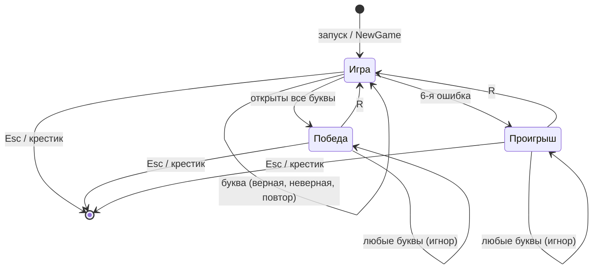
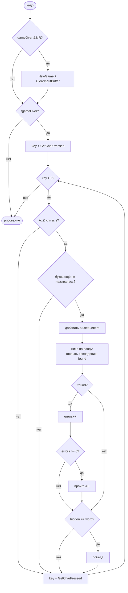

# Тестирование игры «Виселица» (Hangman на raylib)

## 1. Объект и цель тестирования

| Параметр | Значение |
|---|---|
| Объект | Игра «Виселица», файл `main.cpp` (английская версия с перезапуском, коммит `53434ae` и позже) |
| Тип приложения | Настольное графическое приложение на C++ / raylib |
| Цель | Проверить, что игра соответствует правилам «Виселицы», корректно обрабатывает ввод, крайние случаи и перезапуск |
| Методы | Чёрный ящик (по требованиям, без знания кода) и белый ящик (по исходному коду) |
| Уровень | Системное (вся игра) + модульное (логика обработки буквы, `NewGame`, `DrawHangman`) |
| Всего тест-кейсов | **42** (27 — чёрный ящик, 15 — белый ящик) |

## 2. Требования к игре (что проверяем)

Требования восстановлены по `README.md`, `ALGORITHM.md` и интерфейсу игры.

| ID | Требование |
|---|---|
| R1 | При запуске открывается окно 900×550 с заголовком «Hangman» |
| R2 | Загадывается случайное слово из списка 15 слов; оно показывается как строка из `_` той же длины |
| R3 | Игрок вводит буквы с клавиатуры; регистр не важен |
| R4 | Угаданная буква открывается во **всех** позициях слова |
| R5 | Неугаданная буква добавляет 1 ошибку и одну часть человечка |
| R6 | Повторно названная буква не учитывается (ни ошибки, ни изменения) |
| R7 | Все названные буквы выводятся в «Used letters» |
| R8 | Символы, не являющиеся английскими буквами, игнорируются |
| R9 | При 6 ошибках — проигрыш: «YOU LOSE» и показ загаданного слова |
| R10 | Если все буквы открыты — победа: «YOU WIN!» |
| R11 | После окончания игры ввод букв не принимается |
| R12 | После окончания игры клавиша R начинает новую игру с полным сбросом состояния |
| R13 | Окно закрывается крестиком или Esc |

## 3. Немного теории

**Тестирование** — проверка соответствия фактического поведения программы ожидаемому.

- **Чёрный ящик** — тестировщик не смотрит в код, а проверяет поведение по требованиям: «что подаём на вход → что получаем». Техники:
  - *классы эквивалентности* — входы делятся на группы, которые программа обрабатывает одинаково; из каждой группы достаточно одного представителя;
  - *граничные значения* — ошибки чаще всего прячутся на границах (5 и 6 ошибок, буквы `A`/`Z`, самое короткое/длинное слово);
  - *таблица решений* — перебор комбинаций условий и соответствующих действий;
  - *диаграмма состояний* — проверка переходов между состояниями игры;
  - *предугадывание ошибок* — опыт тестировщика: «а что если нажать R во время игры?».
- **Белый ящик** — тесты строятся по исходному коду. Цель — *покрытие*:
  - *покрытие операторов* — каждая строка выполнена хотя бы раз;
  - *покрытие ветвей* — каждое `if`/`while` прошло и по `true`, и по `false`;
  - *покрытие условий* — каждое простое условие внутри составного (`key >= 'A'`, `key <= 'Z'` …) принимало оба значения;
  - *покрытие базовых путей* — число независимых путей равно цикломатической сложности.
- **Крайний (граничный) случай** — ситуация на пределе допустимых значений или в редком состоянии программы.

## 4. Подготовка к тестированию

Слово выбирается случайно, поэтому для воспроизводимости тестов делается **тестовая сборка**: в `main.cpp` список слов временно заменяется на одно слово.

```cpp
vector<string> words = { "class" };        // для большинства тестов
// vector<string> words = { "programming" }; // для тестов длинного слова
```

Почему именно эти слова:

- `class` — самое короткое слово (5 букв), есть повторяющаяся буква `s`, первая буква `c`, последняя `s`;
- `programming` — самое длинное слово (11 букв), повторяются `r`, `g`, `m`;
- `array` — повторяются и `a`, и `r`.

Окружение: Windows 10/11, w64devkit (g++), raylib 6.0, сборка через `Ctrl+Shift+B`.

## 5. Чёрный ящик

### 5.1. Классы эквивалентности для нажатой клавиши

| № | Класс | Представители | Ожидаемая реакция |
|---|---|---|---|
| К1 | Строчная английская буква, есть в слове, не называлась | `c` | Буква открывается |
| К2 | Строчная английская буква, нет в слове, не называлась | `z` | +1 ошибка |
| К3 | Заглавная английская буква | `C`, `Z` | Как К1/К2 |
| К4 | Буква, которая уже называлась (в любом регистре) | `c` → `C` | Ничего не происходит |
| К5 | Цифра | `1`, `0` | Игнорируется |
| К6 | Пробел и знаки | ` `, `?`, `-` | Игнорируется |
| К7 | Русская буква | `ф`, `Я` | Игнорируется |
| К8 | Служебная клавиша | Enter, Backspace, Shift, стрелки | Игнорируется |

### 5.2. Граничные значения

| Величина | Границы | Тесты |
|---|---|---|
| Число ошибок | 0, 1, 5, **6**, (7 — недопустимо) | TC-01, TC-04, TC-13, TC-14, WB-13 |
| Длина слова | 5 (`class`, `array`, `cycle`) и 11 (`programming`) | TC-02, TC-24 |
| Коды символов | `@`(64) / `A`(65), `Z`(90) / `[`(91), `` ` ``(96) / `a`(97), `z`(122) / `{`(123) | WB-01, WB-02 |
| Победа | Победа при 0 ошибках и при 5 ошибках | TC-15, TC-16 |
| Длина списка «Used letters» | Максимум — 13 букв (5 ошибок + 7 из 8 разных букв `programming` + 6-я ошибка) | TC-25 |

### 5.3. Таблица решений «обработка одной нажатой клавиши»

| Условие / Действие | П1 | П2 | П3 | П4 | П5 | П6 |
|---|---|---|---|---|---|---|
| Английская буква? | Нет | Да | Да | Да | Да | Да |
| Уже называлась? | — | Да | Нет | Нет | Нет | Нет |
| Есть в слове? | — | — | Да | Да | Нет | Нет |
| Все буквы открыты после хода? | — | — | Нет | Да | — | — |
| Ошибок стало 6? | — | — | — | — | Нет | Да |
| **Игнорировать** | ✔ | ✔ | | | | |
| Добавить в «Used letters» | | | ✔ | ✔ | ✔ | ✔ |
| Открыть букву | | | ✔ | ✔ | | |
| +1 ошибка | | | | | ✔ | ✔ |
| **Победа** | | | | ✔ | | |
| **Проигрыш** | | | | | | ✔ |
| Тест | TC-10 | TC-07 | TC-03 | TC-15 | TC-04 | TC-14 |

### 5.4. Диаграмма состояний



Покрытие переходов: Игра→Игра (TC-03…TC-12, TC-19), Игра→Победа (TC-15), Игра→Проигрыш (TC-14), Победа→Игра (TC-21), Проигрыш→Игра (TC-20), петли в конечных состояниях (TC-17, TC-18), выход (TC-26).

### 5.5. Тест-кейсы (чёрный ящик)

Предусловие для всех, если не сказано иное: тестовая сборка со словом `class`, игра только что запущена.

| ID | Название | Техника | Шаги | Ожидаемый результат | Треб. |
|---|---|---|---|---|---|
| TC-01 | Начальный экран | Позитивный | Запустить игру | Окно 900×550, заголовок «Hangman»; надпись HANGMAN; виселица без человечка; `Errors: 0 / 6`; «Used letters» пусто; подсказка «Type letters on the keyboard» | R1 |
| TC-02 | Маска слова | Граничные (мин. длина) | Посмотреть на строку слова | `_____` — ровно 5 подчёркиваний | R2 |
| TC-03 | Верная буква | Эквив. К1 | Нажать `c` | Слово `c____`; `Errors: 0 / 6`; Used: `c` | R4, R7 |
| TC-04 | Неверная буква | Эквив. К2 | Нажать `z` | Слово `_____`; `Errors: 1 / 6`; нарисована голова; Used: `z` | R5, R7 |
| TC-05 | Заглавная буква | Эквив. К3 | Нажать `Shift+C` | Как в TC-03, в Used буква записана строчной `c` | R3 |
| TC-06 | Повторяющаяся буква в слове | Эквив. К1 | Нажать `s` | Открылись обе: `___ss`, ошибок 0 | R4 |
| TC-07 | Повтор верной буквы | Эквив. К4 | Нажать `c`, затем ещё раз `c` | Ничего не изменилось после второго нажатия; в Used одна `c` | R6 |
| TC-08 | Повтор неверной буквы | Эквив. К4 | Нажать `z`, затем `z` | `Errors: 1 / 6` (не 2); в Used одна `z` | R6 |
| TC-09 | Повтор в другом регистре | Эквив. К3+К4 | Нажать `z`, затем `Z` | `Errors: 1 / 6` | R3, R6 |
| TC-10 | Цифры | Эквив. К5 | Нажать `1`, `5`, `0` | Ничего не меняется, ошибок 0, Used пусто | R8 |
| TC-11 | Пробел, знаки, служебные клавиши | Эквив. К6, К8 | Нажать пробел, `?`, `-`, Enter, Backspace, стрелки | Ничего не меняется | R8 |
| TC-12 | Русские буквы | Эквив. К7 | Переключить раскладку на русскую, нажать `ф`, `ы`, `в` | Ничего не меняется, ошибок нет | R8 |
| TC-13 | 5 ошибок — игра продолжается | Граничные (6−1) | Нажать `z x q w v` | `Errors: 5 / 6`; голова, туловище, 2 руки, 1 нога; ввод по-прежнему принимается | R5, R9 |
| TC-14 | 6-я ошибка — проигрыш | Граничные (=6) | Нажать `z x q w v b` | Человечек полностью; `YOU LOSE`; `The word was: class`; `Press R to play again`; подсказка про ввод исчезла | R9 |
| TC-15 | Победа без ошибок | Позитивный | Нажать `c l a s` | Слово `class`; `YOU WIN!`; `Press R to play again`; `Errors: 0 / 6` | R10 |
| TC-16 | Победа на последней попытке | Граничные | Нажать `z x q w v`, затем `c l a s` | `YOU WIN!` при `Errors: 5 / 6` | R10 |
| TC-17 | Ввод после проигрыша | Состояния | Проиграть (TC-14), нажать `c`, `t`, `y` | Ничего не меняется: ошибок 6, Used не пополняется | R11 |
| TC-18 | Ввод после победы | Состояния | Выиграть (TC-15), нажать `z`, `t` | Ничего не меняется | R11 |
| TC-19 | R во время игры | Предугадывание ошибок | Нажать `r` до окончания игры | Новая игра **не** начинается; `r` считается догадкой: в `class` её нет → `Errors: 1 / 6`, в Used `r` | R3, R12 |
| TC-20 | Перезапуск после проигрыша | Состояния | Проиграть, нажать `R` | Новая игра: маска `_____`, `Errors: 0 / 6`, Used пусто, человечка нет, надпись YOU LOSE пропала; **буква `r` не попала** в Used | R12 |
| TC-21 | Перезапуск после победы | Состояния | Выиграть, нажать `R` | Как в TC-20 | R12 |
| TC-22 | R в русской раскладке | Предугадывание ошибок | Проиграть, переключить раскладку на русскую, нажать клавишу R (на ней «К») | Новая игра начинается (проверяется физическая клавиша) | R12 |
| TC-23 | Случайный выбор слова | Позитивный | Обычная сборка (15 слов). 20 раз проиграть и перезапустить, записывая слова | Слова из списка, встречаются разные; длина маски каждый раз равна длине слова | R2 |
| TC-24 | Самое длинное слово | Граничные (макс. длина) | Сборка с `programming`. Нажать `p r o g a m i n` | Маска из 11 `_`; после ввода — `programming`, `YOU WIN!`; слово целиком в окне, не наезжает на другие надписи | R2, R4 |
| TC-25 | Максимальный список Used | Граничные | Сборка с `programming`. Нажать `z x q w v`, затем `p r o g a m i`, затем `b` | В Used 13 букв, весь список в пределах окна; проигрыш; `The word was: programming` помещается | R7, R9 |
| TC-26 | Закрытие окна | Позитивный | В каждом из состояний (игра, победа, проигрыш) закрыть крестиком; повторить с Esc | Окно закрывается, процесс завершается без ошибок | R13 |
| TC-27 | Caps Lock | Эквив. К3 | Включить Caps Lock, нажать `c`, `z` | Как TC-03 и TC-04, в Used строчные `c z` | R3 |

## 6. Белый ящик

### 6.1. Граф потока управления (обработка ввода, строки 73–116)



### 6.2. Цикломатическая сложность

V(G) = число решений + 1.

| Функция | Решения | V(G) по решениям | V(G) по простым условиям |
|---|---|---|---|
| `main` | `while(!WindowShouldClose)`, `if(gameOver && R)`, `if(!gameOver)`, `while(key>0)`, `if(буква)`, `if(не называлась)`, `for`, `if(word[i]==letter)`, `if(!found)`, `if(errors>=6)`, `if(hidden==word)`, `if(gameOver)`, `if(win)` — 13 | **14** | **18** (`&&` даёт +1, четыре сравнения в проверке буквы дают +3) |
| `DrawHangman` | 6 `if` | **7** | 7 |
| `NewGame` | нет | 1 | 1 |
| `ClearInputBuffer` | `while` | 2 | 2 |

Значит, для полного покрытия базовых путей `main` нужно минимум 14 независимых путей, `DrawHangman` — 7 (ошибок 0…6).

### 6.3. Тест-кейсы (белый ящик)

| ID | Что покрывает | Входные данные | Ожидаемый результат |
|---|---|---|---|
| WB-01 | Каждое простое условие в `(key>='A' && key<='Z') \|\| (key>='a' && key<='z')` = **false** | Символы `@`(64), `[`(91), `` ` ``(96), `{`(123) | Все игнорируются: не попадают в Used, ошибок 0 |
| WB-02 | Те же условия = **true** на границах | `A`, `Z`, `a`, `z` (слово `class`) | `A`/`a` открывают `a`; `Z`/`z` дают 1 ошибку (второй раз — повтор) |
| WB-03 | `usedLetters.find(letter) != npos` (ветка повтора). В `usedLetters` хранятся пробелы — проверить, что они не мешают поиску | `c`, `l`, `c`, `l` | После 2-го `c`/`l` ничего не меняется; Used = `c l ` |
| WB-04 | Цикл `for`: совпадение на **первой**, **последней** и в нескольких позициях | `class`: `c` (поз. 0), `s` (поз. 3 и 4); `programming`: `p` (0), `g` (3 и 10) | Буквы открываются во всех нужных позициях, индексы не выходят за строку |
| WB-05 | `!found == true`, `errors >= 6 == false` | `z` | `errors = 1`, `gameOver = false` |
| WB-06 | `!found == true`, `errors >= 6 == true` | `z x q w v b` | `gameOver = true`, `win = false` |
| WB-07 | `found == true`, `hidden == word == false` | `c` | `gameOver = false` |
| WB-08 | `found == true`, `hidden == word == true` | `c l a s` | `gameOver = true`, `win = true` |
| WB-09 | Условие `gameOver && IsKeyPressed(KEY_R)` — все комбинации | (а) игра идёт + R; (б) игра окончена, нажата не R; (в) игра окончена + R | (а) нет перезапуска (= TC-19); (б) нет перезапуска; (в) перезапуск |
| WB-10 | `ClearInputBuffer` (регрессия исправления `53434ae`) | Проиграть; нажать `R` **одновременно** с `a` (или зажать R) | В новой игре Used пуст, ни `r`, ни `a` не засчитаны |
| WB-11 | `NewGame` сбрасывает **все** переменные | Проиграть со словом A, перезапуститься (обычная сборка) | `errors = 0`, `usedLetters = ""`, `gameOver = false`, `win = false`, `hidden.length() == word.length()` нового слова |
| WB-12 | Все 7 путей `DrawHangman` | Довести `errors` от 0 до 6 | 0 — только виселица; 1 — голова; 2 — туловище; 3 — левая рука; 4 — правая рука; 5 — левая нога; 6 — правая нога |
| WB-13 | Цикл `while (key > 0)` после проигрыша **в том же кадре** | В одном кадре приходят символы `z x q w v b t` (быстрый набор / одновременное нажатие нескольких клавиш) | Ожидается: `Errors: 6 / 6`, `t` игнорируется |
| WB-14 | Цикл `while (key > 0)` после победы **в том же кадре** | В одном кадре: `c l a s b d e f g h` | Ожидается: победа, `Errors: 0 / 6`, лишние буквы игнорируются |
| WB-15 | Индекс `rand() % words.size()` | Анализ кода | Индекс всегда в `[0; 14]`, список не пустой — выход за границы невозможен |

### 6.4. Покрытие

Набор WB-01…WB-12 вместе с TC-01…TC-27 даёт **100 % покрытия операторов и ветвей** `main`, `NewGame`, `ClearInputBuffer` и `DrawHangman`, а WB-01/WB-02/WB-09 — покрытие всех простых условий. WB-13 и WB-14 проверяют путь «несколько итераций цикла `while` после окончания игры», который обычные тесты не затрагивают — именно там найден дефект.

## 7. Крайние случаи (сводка)

| Крайний случай | Тест |
|---|---|
| Ровно 5 ошибок (ещё можно играть) и ровно 6 (проигрыш) | TC-13, TC-14 |
| Победа на последней попытке | TC-16 |
| Буква встречается в слове несколько раз / в первой и последней позиции | TC-06, WB-04 |
| Повтор буквы, в т.ч. в другом регистре | TC-07, TC-08, TC-09 |
| Самое короткое и самое длинное слово | TC-02, TC-24 |
| Максимально длинный список названных букв | TC-25 |
| Символы на границах диапазонов `A–Z`, `a–z` | WB-01, WB-02 |
| R во время игры / R в русской раскладке | TC-19, TC-22 |
| R нажата вместе с другой клавишей | WB-10 |
| Несколько символов в одном кадре после конца игры | WB-13, WB-14 |
| Русские буквы, цифры, знаки, служебные клавиши | TC-10, TC-11, TC-12 |

## 8. Результаты

Логика обработки ввода (строки 82–116) была скопирована в отдельную программу с подменой `GetCharPressed()` на очередь символов и прогнана на входных данных тестов. Визуальные проверки (TC-01, TC-14, TC-24, TC-25, TC-26, WB-12) выполняются вручную по шагам из таблиц.

| Результат | Тесты |
|---|---|
| ✅ Пройдено (по коду и прогону логики) | TC-02…TC-11, TC-13…TC-21, TC-27, WB-01…WB-11, WB-15 |
| ✅ Пройдено (по анализу кода, нужна ручная проверка на экране) | TC-01, TC-22, TC-23, TC-24, TC-25, TC-26, WB-12 |
| ⚠️ Пройдено, но противоречит документации | TC-12 (см. BUG-02) |
| ❌ Не пройдено | **WB-13, WB-14** (см. BUG-01) |

Фактический вывод прогона для WB-13 и WB-14:

```
class  zxqwvbt     hidden=_____  errors=7  gameOver=1 win=0
class  clasbdefgh  hidden=class  errors=6  gameOver=1 win=1
```

## 9. Найденные дефекты

### BUG-01. После окончания игры буквы из того же кадра продолжают обрабатываться

| Поле | Значение |
|---|---|
| Серьёзность | Средняя |
| Приоритет | Средний |
| Воспроизводимость | Редко: нужно, чтобы несколько символов попали в один кадр (1/60 с) — быстрый набор, одновременное нажатие нескольких клавиш, низкий FPS |
| Найден | Белый ящик, WB-13, WB-14 |
| Место | `main.cpp`, строка 84: `while (key > 0)` |

**Шаги:** тестовая сборка со словом `class`; ввести так, чтобы в одном кадре пришли символы `z x q w v b t`.

**Ожидаемо:** проигрыш, `Errors: 6 / 6`, буква `t` игнорируется.
**Фактически:** `Errors: 7 / 6`, `t` добавлена в Used.

Второй вариант: после победы в том же кадре могут засчитаться ещё 6 неверных букв — на экране `YOU WIN!` при полностью нарисованном человечке и `Errors: 6 / 6`.

**Причина:** внутри `while (key > 0)` не проверяется `gameOver`, хотя он мог стать `true` на предыдущей итерации.

**Исправление:**

```cpp
while (key > 0 && !gameOver) {
```

### BUG-02. README обещает ввод русских букв, а игра их игнорирует

| Поле | Значение |
|---|---|
| Серьёзность | Низкая (дефект документации) |
| Найден | Чёрный ящик, TC-12 |
| Место | `README.md`, раздел «Управление»: «Вводи буквы с клавиатуры (русские или английские)» |

**Ожидаемо по README:** русские буквы принимаются. **Фактически:** код принимает только `A–Z`/`a–z`, слова в списке английские. **Исправление:** в README написать «Вводи английские буквы с клавиатуры».

### Замечания (не дефекты, но стоит учесть)

1. Одно и то же слово может выпасть два раза подряд (TC-23) — по правилам не запрещено, но игроку неприятно.
2. Esc сразу закрывает игру без подтверждения (стандартное поведение raylib) — можно случайно потерять партию.
3. В игре нет счётчика побед/поражений и подсказки, что регистр не важен.

## 10. Матрица покрытия требований

| Треб. | Тесты |
|---|---|
| R1 | TC-01 |
| R2 | TC-02, TC-23, TC-24, WB-15 |
| R3 | TC-05, TC-09, TC-19, TC-27, WB-02 |
| R4 | TC-03, TC-06, TC-24, WB-04 |
| R5 | TC-04, TC-13, WB-05, WB-12 |
| R6 | TC-07, TC-08, TC-09, WB-03 |
| R7 | TC-03, TC-04, TC-25 |
| R8 | TC-10, TC-11, TC-12, WB-01 |
| R9 | TC-13, TC-14, TC-25, WB-06 |
| R10 | TC-15, TC-16, WB-08 |
| R11 | TC-17, TC-18, WB-13, WB-14 |
| R12 | TC-19, TC-20, TC-21, TC-22, WB-09, WB-10, WB-11 |
| R13 | TC-26 |

Каждое требование покрыто хотя бы одним тестом.

## 11. Вывод

Разработано 42 тест-кейса: 27 по методу чёрного ящика (классы эквивалентности, граничные значения, таблица решений, диаграмма состояний, предугадывание ошибок) и 15 по методу белого ящика (покрытие операторов, ветвей, условий; цикломатическая сложность `main` = 14). Основные правила игры работают верно. Найдено 2 дефекта: BUG-01 (логика: ввод после окончания игры в том же кадре, средняя серьёзность) и BUG-02 (документация, низкая серьёзность).
